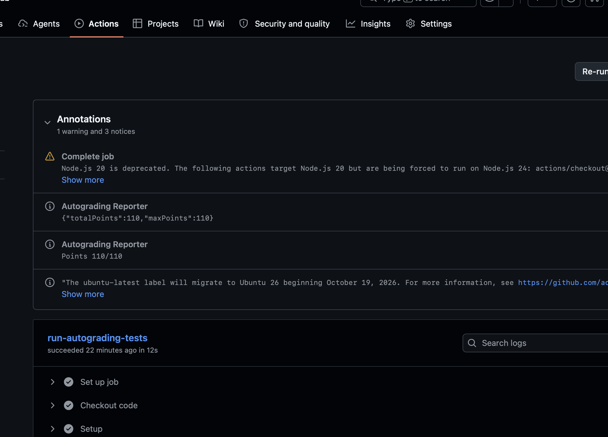

# Lab1：Data Lab 实验报告

- 姓名：Yuanke LI
- 学号：25800190120
- 日期：2026 年 10 月 9 日
- 实验代码：[bits.c](bits.c)

> 评测结果：GitHub Actions 线上评测得到 110/110，评测任务执行成功，汇总截图已附在报告中。由于本地 macOS 环境无法直接运行完整课程评测，本报告以线上评测截图记录正式测试结果，并在下文说明未提供本地命令截图的原因。

## 一、实验目的与环境

本实验通过实现 19 个受限运算函数，练习 32 位二进制补码、掩码构造、移位、溢出判断，以及 IEEE 754 单精度浮点数的编码与舍入。整数题主要使用 `! ~ & ^ | + << >>`，并限制常量范围和操作数；浮点题允许整数控制流，但不能直接进行浮点运算。

代码在 arm64 架构的 macOS 上编辑。课程 README 推荐使用支持 32 位编译的 x86-64 Linux 环境；仓库中的 `dlc` 是 Linux ELF 程序，不能直接在 macOS 上执行。本次线上评测通过 GitHub Actions 的 Ubuntu 环境完成。仓库实际 Workflow 使用 `-O -Wall -fwrapv` 编译，不带 `-m32`；其中 `int` 和 `unsigned` 仍为 32 位。

本地额外使用 macOS 的 Clang 编译仓库原有的 `btest`、`decl.c`、`tests.c` 与完成后的 `bits.c`，保留 `-O -Wall -fwrapv`，未使用 `-m32`。该检查用于验证算法结果，不能替代课程 Linux 环境的完整评测。没有修改测试源码、Makefile 或评分配置。

## 二、测试记录与截图

### 本地运行限制说明

本人使用 arm64 架构的 macOS，未配置课程要求的 x86-64 Linux 评测环境。仓库中的 `dlc` 是 Linux ELF 可执行文件，无法在本机直接运行；课程 Makefile 默认使用 `-m32` 编译，也不适用于当前 Mac 的原生编译环境。因此，无法在本地按照课程原有流程完整执行规则检查和正确性评测，未提供本地执行 `./check_ops.py bits.c` 与课程默认构建的 `./btest` 的终端截图。

按照 README 中针对 Mac 用户的说明，本次将代码提交并推送至 GitHub，通过 Actions 的 Linux 环境进行正式评测。以下附上真实的线上评测汇总截图，作为测试结果记录。另行编译的 macOS 原生 `btest` 仅作为补充正确性检查，与完整课程评测有所区别。

### 1. 运算符和操作数检查

正式检查命令为：

```bash
./check_ops.py bits.c
```

该脚本内部调用仓库自带的 `dlc`，本地无法直接运行。GitHub Actions 按题执行 `./check_ops.py --function 函数名 bits.c`，再执行该题正确性测试。所附线上汇总截图显示总分 110/110；根据仓库评分配置，每题只有规则检查和正确性测试均通过才得分，因此该次评测的 19 题均通过了两项检查。

### 2. 正确性测试

在课程 Linux 环境中，每次修改代码后先重新编译，再执行：

```bash
make clean
make all
./btest
```

本次已完成一次 macOS 原生编译的正确性测试，使用仓库原有测试源码，19 个函数的 `Errors` 均为 0，最后输出：

```text
Total points: 110/110
```

完整补充测试输出保存在 [macOS本地btest结果.txt](macOS本地btest结果.txt)。正式测试由 GitHub Actions 在 Linux 环境中按题执行 `./btest -f 函数名`，其规则和正确性检查通过情况由下方线上评测汇总记录说明。

提交 Markdown 时，应将报告、`GitHub自动评测结果.png` 和所链接的补充测试记录一起提交，并保持它们在同一目录，避免图片和记录路径失效。

### 3. GitHub Actions 线上评测结果

2026 年 10 月 9 日提供的 GitHub Actions 页面截图显示，`run-autograding-tests` 任务执行成功。`Autograding Reporter` 同时给出 `{"totalPoints":110,"maxPoints":110}` 和 `Points 110/110`，确认该次线上评测取得满分。



截图中的 Node.js 版本警告和 Ubuntu 运行环境迁移通知属于 Workflow 运行环境提示。该次任务已成功结束，评分汇总为 110/110。

这张截图记录线上总分及任务状态。由于前述本地运行限制，本报告使用该线上评测截图说明正式测试结果，未另附两条完整命令的本地终端截图。

### 4. 独立源码检查

本地对函数体中的运算符进行了独立计数，并检查了整数题的运算符集合、常量范围和禁用控制流。当前计数均不超过题目限制，结果如下。此表来自本地源码检查，最终计数以 Linux `./check_ops.py bits.c` 为准。

| 编号 | 函数 | 本地计数 | 题目上限 |
|---|---|---:|---:|
| P1 | `signMask` | 1 | 2 |
| P2 | `bitXor` | 7 | 8 |
| P3 | `negativePart` | 4 | 6 |
| P4 | `copyByteWithin` | 9 | 12 |
| P5 | `logicalShift` | 6 | 20 |
| P6 | `swapNibblePairs` | 9 | 18 |
| P7 | `secondLowestZeroBit` | 7 | 8 |
| P8 | `oddParity` | 12 | 56 |
| P9 | `rotateRightBits` | 12 | 16 |
| P10 | `roundEvenPow2` | 14 | 24 |
| P11 | `midpointTowardFirst` | 20 | 32 |
| P12 | `isBetweenEitherOrder` | 30 | 48 |
| P13 | `mul5Sat` | 17 | 30 |
| P14 | `classifyAdd3` | 25 | 52 |
| P15 | `floatScaleThreeHalves` | 36 | 60 |
| P16 | `floatRoundEven` | 26 | 65 |
| P17 | `float_i2f` | 32 | 40 |
| P18 | `bitCount` | 28 | 40 |
| P19 | `bitReverse` | 34 | 34 |

## 三、各函数的实现思路

以下说明对应当前 `bits.c` 的实际代码。涉及有符号左移、溢出和负数右移的推导，均采用课程规定的 32 位补码位向量模型。

### P1：`signMask`

将常量 `1` 左移 31 位，把唯一的置位移动到最高位，得到 `0x80000000`。这样不需要直接使用超出整数题常量范围的大常量，只使用一次左移。

### P2：`bitXor`

异或在两个输入位不同时为 1。实现使用 `~(~x & ~y) & ~(x & y)`：第一部分通过德摩根律得到按位或，第二部分排除两个输入位同时为 1 的情况。表达式只包含 `~` 和 `&`，满足本题的额外限制。

### P3：`negativePart`

算术右移 `x >> 31` 在负数时得到全 1 掩码，在非负数时得到 0。用 `~x + 1` 构造补码取负，再与符号掩码相与，即可在负数时保留取负结果，在其他情况下返回 0。对 `INT_MIN`，取负结果按课程模型保留低 32 位。

### P4：`copyByteWithin`

先用 `src << 3` 和 `dst << 3` 将字节编号转换为位偏移。将源字节右移到最低字节并与 `255` 相与，得到其 8 位内容；将 `255` 左移到目标位置构造掩码。先清空目标字节，再把源字节左移到目标位置并按位或回去，其他字节保持原值。

### P5：`logicalShift`

先执行算术右移，再清除符号扩展位。掩码使用 `~(((1 << 31) >> n) << 1)` 构造：其低 `32-n` 位为 1，其余位为 0。将 `x >> n` 与该掩码相与，就得到逻辑右移结果。该表达式在 `n=0` 和 `n=31` 时也有效，所有实际移位量均在 0–31 内。

### P6：`swapNibblePairs`

由小常量 `15` 通过移位与按位或构造 `0x0F0F0F0F`。用掩码选出每个字节的低四位并左移 4 位；将原数右移 4 位后再与掩码相与，选出每个字节的高四位。将两部分按位或，完成四个字节内部的半字节交换，并消除右移带来的符号扩展影响。

### P7：`secondLowestZeroBit`

先取 `zeros = ~x`，把原数中的 0 位转换为 1 位。对一个位模式执行 `zeros & (zeros-1)` 可以清除最低的 1，本题用 `zeros + ~0` 表示减一。清除后再用 `zeros & (~zeros + 1)` 提取最低的剩余 1，它就是原数第二低的 0 所在位置。若原数不足两个 0 位，结果自然为 0。

### P8：`oddParity`

依次将 `x` 与自身右移 16、8、4、2、1 位后的结果异或，把全部 32 位的异或值折叠到最低位。最低位为 1 表示原数中 1 的数量为奇数。题目要求的返回值恰好相反，因此用 `(~x) & 1` 得到奇校验补充位：原数中 1 的数量为偶数时返回 1，为奇数时返回 0。

### P9：`rotateRightBits`

先用 `n & 31` 把旋转位数归约到 0–31。右半部分采用与 P5 相同的掩码实现逻辑右移；左半部分将原数左移 `(-shift) mod 32` 位，这一移位量用 `(~shift + 1) & 31` 表示。将两部分按位或即可完成循环右移。旋转 0 位或 32 的倍数时，两边都只移 0 位，不会出现移位 32 位的问题。

### P10：`roundEvenPow2`

设商为 `quotient = x >> n`，半个步长为 `half = 2^(n-1)`。计算 `x + half - 1 + (quotient & 1)`，然后用掩码清除最低 `n` 位。余数小于半步长时不会进位，大于半步长时会进位；恰好等于半步长时，只有原商为奇数才进位，从而选择商为偶数的倍数。代码用 `+ ~0` 表示减一，避免禁用的减号。

### P11：`midpointTowardFirst`

直接计算 `x+y` 可能溢出，因此先使用 `(x & y) + ((x ^ y) >> 1)` 计算数学中点向下取整的结果。若 `x ^ y` 的最低位为 1，说明两数之和为奇数，中点恰好在两个相邻整数之间。

此时需要判断 `x > y`：异号时根据符号直接判断，同号时根据 `y-x` 的符号判断，同号相减不会产生有符号溢出。当中点不为整数且 `x > y` 时，把向下取整结果加一；其他情况保留原结果，从而始终向第一个参数靠近。

### P12：`isBetweenEitherOrder`

分别判断 `x < a` 和 `x < b`。每次比较都先检查两数是否异号：异号时由 `x` 的符号决定大小，同号时检查差值的符号，避免把溢出的减法结果误用为大小关系。

如果两次严格小于判断不同，说明 `x` 位于两个端点之间；再用 `!(x ^ a)` 和 `!(x ^ b)` 补上与端点相等的情况。这样无需先对 `a`、`b` 排序，也能处理端点相同和极值输入。

### P13：`mul5Sat`

依次计算 `2x`、`4x` 和 `5x`。检查每个中间结果是否与原数发生符号变化，只要有一次变化就视为溢出。检查中间结果可以发现连续溢出后最终符号又恢复的情况，避免只看 `5x` 的符号造成漏判。

若没有溢出，返回 `5x` 的低 32 位结果；若溢出，则根据原数符号选择 `INT_MAX` 或 `INT_MIN`。通过全 1 或全 0 的溢出掩码组合两种结果，不使用条件语句。

### P14：`classifyAdd3`

先计算低 32 位的 `firstSum = x+y`，再计算 `finalSum = firstSum+z`。同号相加但结果异号时发生有符号溢出，判断掩码使用 `~(u ^ v) & (u ^ sum)` 的符号位。

为每次加法记录一个修正系数：正溢出记为 `+1`，负溢出记为 `-1`，未溢出记为 `0`。精确数学和等于 `finalSum` 加上两个修正系数之和乘以 `2^32`。因此，系数之和为正、负或零时，分别返回 `1`、`-1` 或 `0`。这种做法能够处理第一次溢出被第三个操作数抵消的情况，不能简单把两次溢出标志做按位或。

### P15：`floatScaleThreeHalves`

先拆出符号位、阶码和尾数字段。阶码为 255 时原样返回，保留 NaN 的位模式和无穷大；正规格化数补上隐含的最高位 1，非规格化数不补。

将整数有效数连续相加，精确计算三倍有效数。通常右移 1 位表示除以 2；对需要规格化到下一阶码的正规格化结果，右移 2 位并增加阶码。保留被舍弃部分作为余数，与半个舍入单位比较：大于半单位时进位，等于半单位时仅在保留部分为奇数时进位，实现最接近偶数舍入。

非规格化结果可直接将舍入后的有效数与符号位组合，跨过最小正规格化数边界时相应阶码位会自然置位。正规格化数还需要处理舍入进位导致的再次规格化和阶码溢出。零的符号通过保留原符号位得到保持，避免先舍入乘三结果再除二造成两次舍入。

### P16：`floatRoundEven`

按阶码分段处理。阶码至少为 150 的有限单精度数已经没有小数位，同时这一分支也覆盖 NaN 和无穷大，因此直接返回输入。

阶码小于 126 时，绝对值小于 0.5，返回保留符号的零；阶码等于 126 时，精确的 ±0.5 按偶数规则舍入到带符号的零，绝对值大于 0.5 的数舍入为 ±1。

其他情况下，用 `150-exponent` 求出小数部分所占位数，构造掩码取得舍弃余数并清除小数位。余数大于一半时进位；恰好为一半时检查保留整数的最低位，仅在其为奇数时进位。向清零后的位模式加上一个整数单位，也会正确处理尾数向阶码的进位。

### P17：`float_i2f`

输入为 0 时直接返回 0。先保存符号，将输入赋给 `unsigned`，负数通过无符号补码取负得到幅值，避免对 `INT_MIN` 在有符号域中求绝对值。

通过右移扫描确定幅值最高置位的位置，由此得到加上偏置 127 的阶码。如果整数有效位不超过 24 位，左移对齐即可精确表示；否则保留最高 24 位，比较舍弃余数与半单位，并在中点时依据保留部分的奇偶性执行舍入。若舍入产生第 25 位进位，则右移有效数并增加阶码，最后拼接符号、阶码和 23 位尾数字段。

### P18：`bitCount`

使用分组并行求和。先构造 `0x55555555`、`0x33333333` 和 `0x0F0F0F0F` 三个掩码，将每两位中的 1 相加，再把两个两位计数合并为四位计数，随后合并为每字节的计数。

最后通过右移 8 位和 16 位继续累计各字节计数。32 位输入最多有 32 个 1，返回最低 6 位即可得到最终数量。这种方法不需要循环，同时通过掩码消除算术右移的符号扩展对分组结果的影响。

### P19：`bitReverse`

按 1、2、4、8、16 位的分组大小，依次交换相邻组。完成所有交换后，原来的第 `i` 位会移到第 `31-i` 位。

本题操作数上限为 34，因此掩码的构造也需要节省操作。先用 `255 | (255 << 8)` 构造 `0x0000FFFF`，再将掩码与自身左移后的结果异或，依次得到 `0x00FF00FF`、`0x0F0F0F0F`、`0x33333333` 和 `0x55555555`。前四轮通过掩码分别选出左右组再交换，最后用左移 16 位与带掩码的右移 16 位交换两半。本地源码计数为 34，恰好达到上限。

## 四、实验体会

整数题的关键是把条件转化为掩码，并在运算前分析符号和溢出。大小比较需要区分同号和异号；求平均值应避免直接相加；多个操作数相加时，应跟踪中间溢出对精确结果的修正，而不只观察最终位模式。

浮点题的关键是区分符号、阶码、隐含最高位和尾数字段，并统一处理最接近偶数舍入。余数恰好位于中点时，是否进位取决于保留部分的最低位；NaN、无穷大、带符号的零、非规格化数和舍入进位都需要单独考虑。

算法正确性和编码规则合法性是两项不同的检查。本次 macOS 补充正确性测试得到 110/110，GitHub Actions 线上汇总截图也显示 110/110。线上评分按题结合规则检查和正确性测试，验证了该次评测的两项要求。通过线上 Linux 环境完成正式测试，解决了本地 macOS 无法直接运行完整课程评测的问题。

## 五、引用与参考资料

1. 课程仓库 [README.md](README.md)：实验环境、编码规则、题目限制、测试流程和提交要求。
2. 课程提供的 [bits.c](bits.c) 文件头及各函数题目注释：函数语义、允许的运算符、最大操作数和边界要求。
3. 课程提供的 [tests.c](tests.c)、[decl.c](decl.c) 和 [btest.c](btest.c)：参考行为、测试参数及正确性测试程序。
4. 课程提供的 [check_ops.py](check_ops.py) 和 [Makefile](Makefile)：规则检查方法和课程编译选项。
5. OpenAI Codex：整理本报告。本地测试记录来自实际运行；线上评测结论依据提供的真实 GitHub Actions 页面截图及仓库的评分配置。

